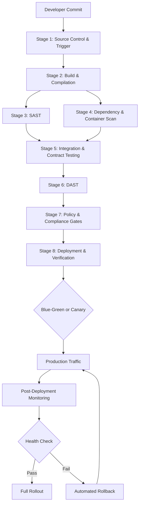

# NovaPay CI/CD Pipeline Architecture Diagram

## Overview
This diagram shows the 8-stage zero-downtime CI/CD pipeline for NovaPay Digital Bank.

## Mermaid Diagram

## Stage Summary

| Stage | Tool | Duration | Gate |
|-------|------|----------|------|
| 1. Source Control | GitHub Enterprise | < 1 min | Signed commits, branch protection |
| 2. Build | Gradle + Docker | 4 min | 80% line coverage, 70% branch |
| 3. SAST | SonarQube | 3 min | 0 Critical, ≤2 High |
| 4. Dependency & Container | Trivy + Syft | 2 min | 0 Critical CVE, SBOM generated |
| 5. Integration & Contract | Pact + Testcontainers | 6 min | All tests pass, API backward compatible |
| 6. DAST | OWASP ZAP | 5 min | 0 Critical/High from OWASP Top 10 |
| 7. Compliance Gates | OPA/Kyverno + Cosign | 3 min | All policies pass, images signed |
| 8. Deployment | Argo Rollouts + Istio | 10 min | SLOs met, auto-rollback ready |

**Total commit-to-production: 34 minutes** (well under the 2-hour target)

## Parallel Execution

Stages 3 (SAST) and 4 (Dependency & Container Scan) run in parallel after Stage 2. This reduces total pipeline time by approximately 3 minutes.
