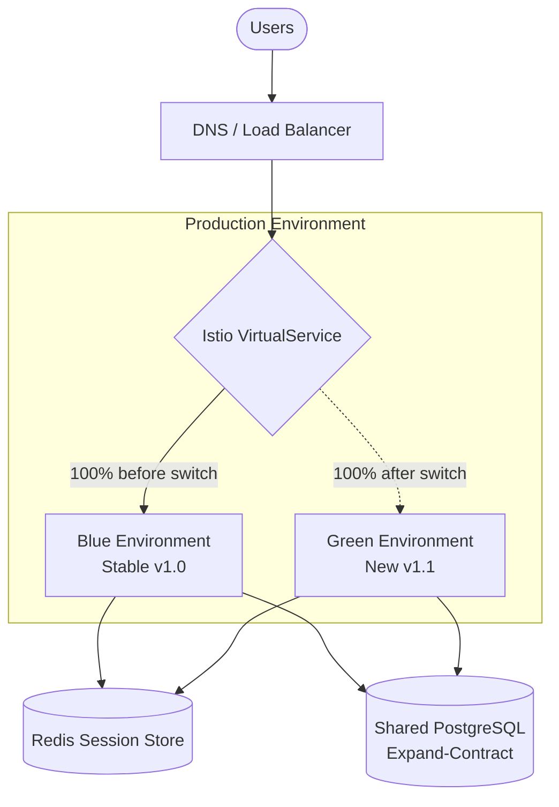
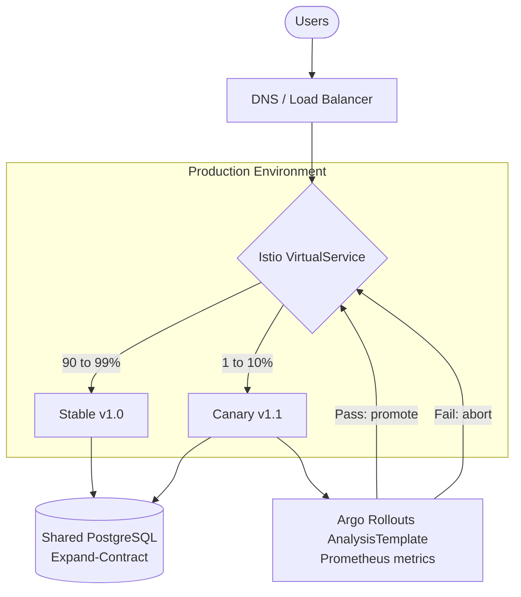

# Deployment Topology Diagram

## 1. Blue-Green (standard releases)

Green is verified with smoke tests, then Istio switches all traffic. If Green fails during the 15-minute monitoring window, traffic is routed back to Blue within 30 seconds.

## 2. Canary (high-risk releases)

Traffic increases in phases (1 to 2%, 5 to 10%, 25 to 50%, 100%). If the canary fails the automated analysis or a Category A trigger fires, traffic returns to the stable version.
