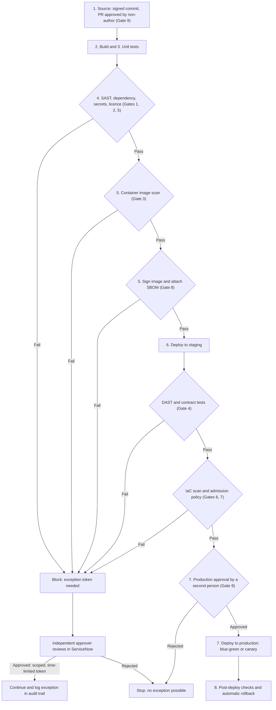

# Gate Orchestration Flow

Gates follow the eight pipeline stages. Any failure blocks the pipeline. An independently approved, single-use exception token is the only way past a failed gate (except Gate 9).

Every gate result and every exception is written to the audit log (see `compliance-gates.md`, section 3).
